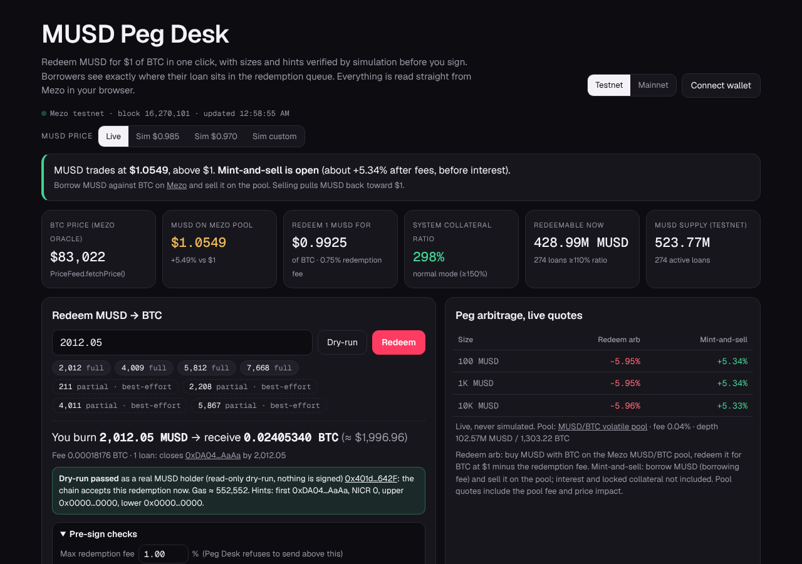
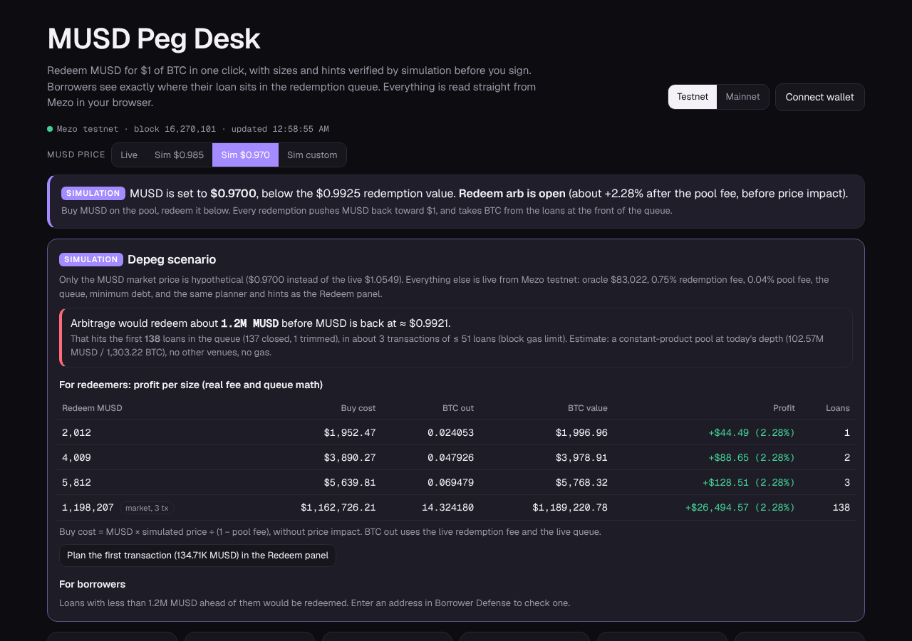
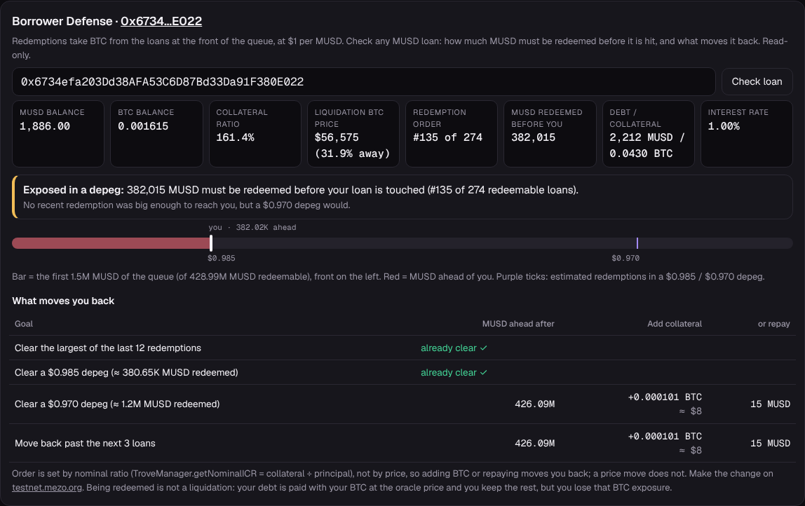
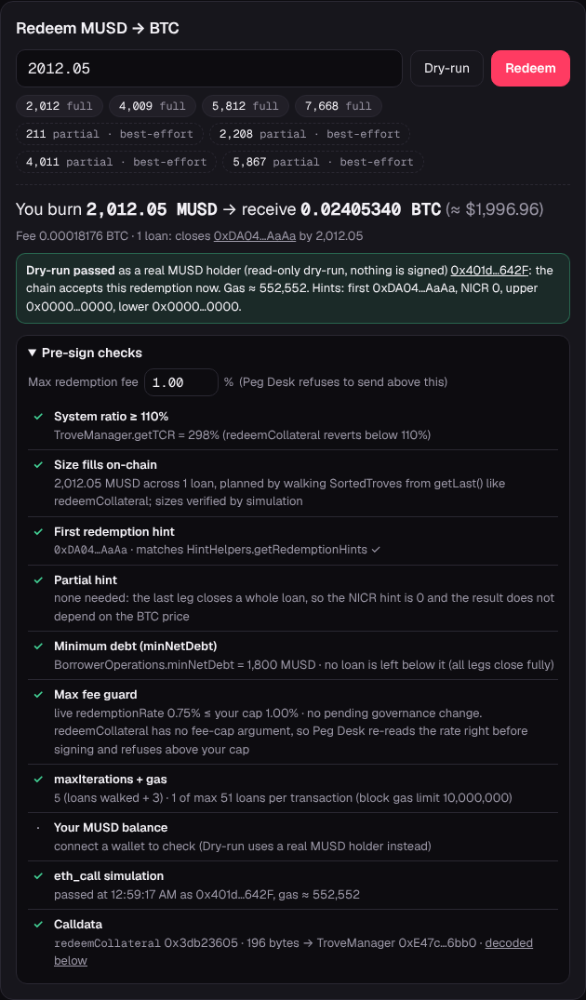
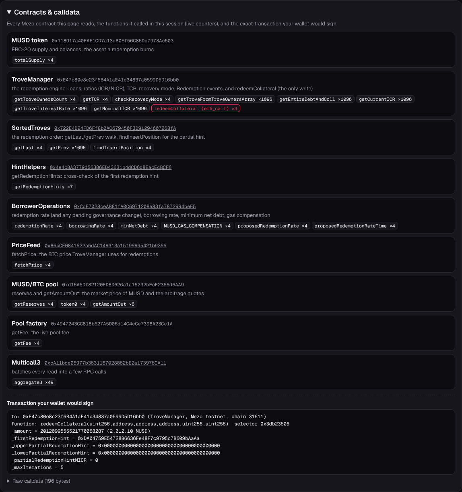
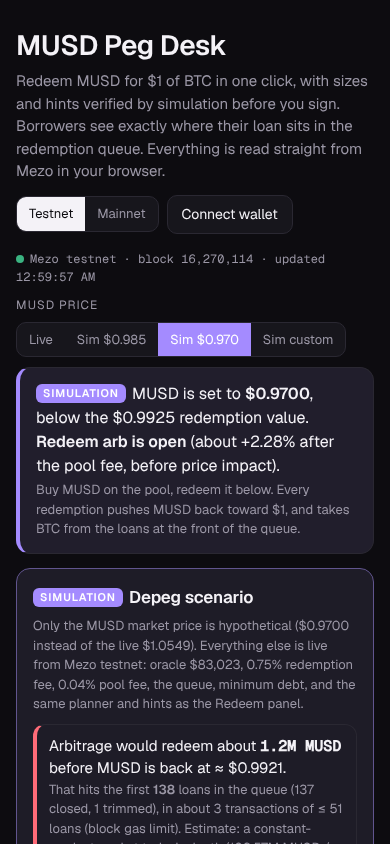

# MUSD Peg Desk

**Redeem MUSD for $1 of BTC in one click, and show every MUSD borrower where their loan sits in the redemption queue.** One static page, no backend, read live from Mezo.

**Live app:** LIVE_URL · **Video (2 min):** VIDEO_URL · **Deck:** DECK_URL

Mezo Buildathon (AKINDO) Wave 1 · Track 1 (MUSD DeFi) + Track 2 (Access & Distribution) · Chain: **Mezo testnet** (sends) and Mezo mainnet (read-only view and dry-run).



## 30-second summary

- **The problem.** Redemption is MUSD's peg defense: anyone can burn 1 MUSD for $1 of BTC (0.75% fee). It is used heavily (**500 redemptions, about 892.5K MUSD, on mainnet between Oct 8 and Oct 20, 2026**), yet the official route is a 6-field form in the block explorer. Borrowers get no warning that their loan is next in line.
- **For redeemers.** Peg Desk plans the redemption exactly like `TroveManager.redeemCollateral`, offers only sizes that fill on-chain, builds every hint, checks the minimum debt, the fee cap and the gas limit, simulates with `eth_call`, then sends from your wallet.
- **For borrowers.** Borrower Defense shows how much MUSD must be redeemed before a loan is hit, whether recent redemptions or a $0.985 / $0.970 depeg would reach it, and exactly how much BTC to add (or MUSD to repay) to move back.
- **Depeg simulator.** One click sets a hypothetical MUSD price, clearly labeled SIMULATION, and shows the arb profit per size and which loans get redeemed. It uses the same live fee, queue and planner as the Redeem panel.
- **Integration depth.** It reads 7 Mezo contracts plus Multicall3 and lists every call in a "Contracts & calldata" drawer. Its only write is `TroveManager.redeemCollateral`, the peg mechanism itself.

## Who it serves

| User | Today | With Peg Desk |
|---|---|---|
| Arbitrageurs / keepers | Hand-fill hints in the explorer; small sizes revert | Valid-size chips, live arb quotes, profit table, one-click send |
| MUSD holders | No simple way to get BTC at $1 | Redeem in one click at the oracle price, minus the fee |
| Borrowers | No view of the redemption queue | Queue position, "MUSD ahead", depeg exposure, the exact fix |

## Screenshots

| Depeg simulator (SIMULATION) | Borrower Defense |
|---|---|
|  |  |

| Pre-sign checks | Contracts & calldata | Phone (390 px) |
|---|---|---|
|  |  |  |

Mainnet read-only view: [img/mainnet.png](img/mainnet.png). Full testnet page: [img/testnet-desktop.png](img/testnet-desktop.png).

## How it uses MUSD and Mezo

All reads are batched through Multicall3 (`0xcA11bde05977b3631167028862bE2a173976CA11`). The drawer in the app shows live call counters for each contract.

| Contract | Testnet (31611) | Mainnet (31612) | What Peg Desk calls |
|---|---|---|---|
| MUSD | `0x118917a40FAF1CD7a13dB0Ef56C86De7973Ac503` | `0xdD468A1DDc392dcdbEf6db6e34E89AA338F9F186` | `totalSupply`, `balanceOf` |
| TroveManager | `0xE47c80e8c23f6B4A1aE41c34837a0599D5D16bb0` | `0x94AfB503dBca74aC3E4929BACEeDfCe19B93c193` | `getTroveOwnersCount`, `getTroveFromTroveOwnersArray`, `getEntireDebtAndColl`, `getCurrentICR`, `getNominalICR`, `getTroveInterestRate`, `getTCR`, `checkRecoveryMode`, `Redemption` events, **`redeemCollateral` (the only write)** |
| SortedTroves | `0x722E4D24FD6Ff8b0AC679450F3D91294607268fA` | `0x8C5DB4C62BF29c1C4564390d10c20a47E0b2749f` | `getLast`, `getPrev` (the queue walk), `findInsertPosition` (partial hint) |
| HintHelpers | `0x4e4cBA3779d56386ED43631b4dCD6d8EacEcBCF6` | `0xD267b3bE2514375A075fd03C3D9CBa6b95317DC3` | `getRedemptionHints` (first-hint cross-check) |
| BorrowerOperations | `0xCdF7028ceAB81fA0C6971208e83fa7872994beE5` | `0x44b1bac67dDA612a41a58AAf779143B181dEe031` | `redemptionRate`, `proposedRedemptionRate(Time)`, `borrowingRate`, `minNetDebt`, `MUSD_GAS_COMPENSATION` |
| PriceFeed | `0x86bCF0841622a5dAC14A313a15f96A95421b9366` | `0xc5aC5A8892230E0A3e1c473881A2de7353fFcA88` | `fetchPrice` |
| MUSD/BTC pool | `0xd16A5Df82120ED8D626a1a15232bFcE2366d6AA9` | `0x52e604c44417233b6CcEDDDc0d640A405Caacefb` | `getReserves`, `token0`, `getAmountOut` |
| Pool factory | `0x4947243CC818b627A5D06d14C4eCe7398A23Ce1A` | `0x83FE469C636C4081b87bA5b3Ae9991c6Ed104248` | `getFee` |

Sources: the addresses are from mezo.org/docs (MUSD Redemptions); the RPCs are `https://rpc.test.mezo.org` and `https://mainnet.mezo.public.validationcloud.io`; redemption history comes from the public explorer API.

## How a redemption is built

1. **Read.** Loads every loan, then walks `SortedTroves` from `getLast()` through `getPrev()`, the same order `redeemCollateral` uses. Loans under 110% are skipped.
2. **Plan.** Mirrors `redeemCollateral` loan by loan:
   - full loans are closed;
   - the last loan is trimmed so it keeps at least `minNetDebt` (plus 1 MUSD for accruing interest);
   - one transaction is capped at the number of loans that fits the live block gas limit (about 51 at 10M gas; about 160k gas per loan, measured).
   - Sizes are verified by simulation.
3. **Hints.** Computes the partial NICR and centres it in TroveManager's narrow acceptance window. Gets the insert position from `SortedTroves.findInsertPosition` and cross-checks the first hint against `HintHelpers.getRedemptionHints`.
4. **Guards.**
   - System ratio must be at least 110%.
   - **Max-fee guard:** `redeemCollateral` has no fee-cap argument, so Peg Desk re-reads `redemptionRate()` right before signing and refuses to send above your cap. It also shows any pending governance change, which has a 7-day timelock.
   - Your MUSD balance must cover the amount.
5. **Simulate.** `eth_call` and `estimateGas` from your wallet, or (read-only) from a real MUSD holder.
6. **Send** with any EIP-1193 wallet. Peg Desk switches to chain 31611 (or adds it), then decodes the `Redemption` event from the receipt.

"Full" sizes close whole loans and do not depend on the BTC price. A partial trim is accepted only if the oracle has barely moved since the hint was computed. The UI says so and recomputes the hint right before signing.

## Borrower Defense: the maths

- **MUSD ahead** is the sum of the redeemable net debt of every loan before yours in `SortedTroves` order.
- **Depeg exposure.** It estimates how much MUSD arbitrage would redeem if the MUSD/BTC pool (constant product, today's depth) sat at $0.985 or $0.970. Arbitrage stops at the redemption value net of fees.
- **What moves you back.** The queue is ordered by nominal ratio (`getNominalICR` = collateral ÷ principal), not by price. So for each goal Peg Desk finds the loan you must overtake and computes:
  - the BTC to add, or
  - the MUSD to repay (interest first, as the contract applies it; refused if it would break `minNetDebt`).

## Verify it yourself (60 seconds)

1. Open LIVE_URL. It is testnet by default; add `?net=mainnet` for mainnet.
2. Click a chip marked **full** (for example 2,012), then **Dry-run**. You get "Dry-run passed" plus the gas, and every pre-sign check turns green.
3. Click **Sim $0.970**. You see the SIMULATION banner, the profit table and the number of loans hit. Click **Live** to return.
4. In Borrower Defense, click the example "exposed in a $0.970 depeg" (or open `?wallet=0x…` for any address).
5. Open **Contracts & calldata** to see every contract, the live call counters and the decoded `redeemCollateral` calldata.

Automated (Playwright + Chromium, live chain; nothing is signed):

```bash
pip install playwright && playwright install chromium
python3 tools/verify.py            # 10 checks: dry-run, pre-sign checks, drawer, scenarios, Borrower Defense,
                                   # max-fee guard blocks a send, mock-wallet payload replayed as eth_call, 390 px, console
python3 tools/verify_amounts.py    # dry-runs every suggested size; all "full" sizes must pass
```

URL parameters: `net=mainnet`, `wallet=0x…`, `amt=2012.05`, `scenario=0.97`.

## Business model

Peg Desk sits on the flow that keeps MUSD at $1. Two revenue lines, both in MUSD:

1. **Keeper fee on profitable redemptions.** The Wave 2 executor contract (swap BTC→MUSD on the pool + `redeemCollateral` in one transaction) takes a small share of the realized arbitrage profit, for example 10%, and only when the trade clears a min-out. Mainnet's recent pace is about 892.5K MUSD redeemed in 12 days, roughly 2.2M MUSD a month. At a 0.5–1% edge that is about $11–22K of arbitrage profit a month. A 10% share is about $280–560 a month if Peg Desk routes a quarter of the flow, or $1.1–2.2K at full share. It grows with every depeg, which is exactly when the peg needs keepers.
2. **Redemption alerts for borrowers.** A paid watch on a loan: Telegram or web-push when it enters the first N MUSD of the queue, or when a depeg scenario would reach it. Pricing target: 2–5 MUSD per loan per month. The free page stays free.

Both lines extend MUSD utility: more redemption liquidity holds the peg tighter, and fewer surprised borrowers makes MUSD a safer loan.

## Roadmap

- **Wave 2 (Nov 2–15):**
  - **Atomic arb executor** on Mezo testnet, verified on the explorer: swap on the MUSD/BTC pool, then `redeemCollateral`, with min-out and pre-trade simulation. This makes redemption arbitrage composable with Mezo pools.
  - **Borrower alerts** (Telegram / web-push) for watched loans.
- **December:** mainnet sends after an external review; a keeper bot that runs the executor when the edge crosses a threshold; a public alert subscription.
- **Q1 2027:** an SDK and an embeddable widget so wallets and Mezo front-ends can show "your queue position" and "redeem at $1" natively.

## Security and limits

- No backend, no keys, no tracking. The page is one HTML file plus ethers 6.13.4 from cdnjs.
- The only transaction it can request is `TroveManager.redeemCollateral` on testnet, signed in your own wallet after a successful `eth_call`. Mainnet is read-only and dry-run only in this version.
- Depeg scenarios change only the MUSD market price and are always labeled SIMULATION. Volumes are estimates: a single constant-product pool, no other venues, no gas.
- Independent open-source tool. Not affiliated with Mezo. Not financial advice.

## How it was built

The code, tests, deck and demo were written with heavy help from AI coding assistants (Claude), directed and reviewed by the entrant. Every claim in this README is checked against the live chain by `tools/verify.py` (Playwright, read-only, no keys). The demo voice-over is synthetic (Piper TTS).

## Run locally

It is one static file: open `index.html`, or serve the folder (`npx serve .`) and use any static host (GitHub Pages works as is).

License: [MIT](LICENSE).
